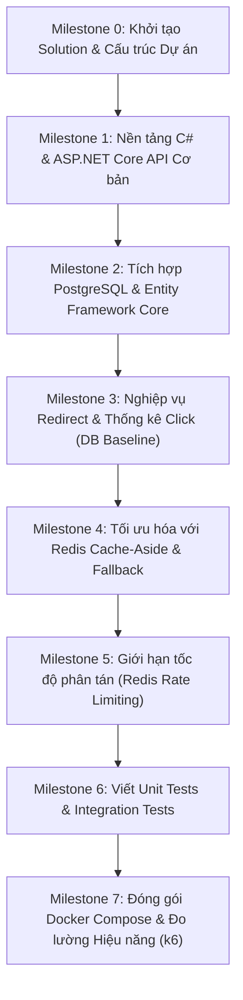

# Kế Hoạch Học Tập & Lộ Trình Triển Khai (Learning Roadmap)

Lộ trình này được thiết kế để bạn từng bước làm quen, làm chủ ngôn ngữ **C#** và framework **ASP.NET Core** thông qua dự án **QLink**.  
Phương châm triển khai: **Xây dựng từng lớp vững chắc (Iterative & Incremental)** — Chạy đúng và ổn định với PostgreSQL trước, sau đó mới tối ưu hóa với Redis và containerize.

---

## 🗺️ Tổng Quan Các Giai Đoạn (Milestones)



---

## 📍 Chi Tiết Từng Giai Đoạn

### Giai Đoạn 0: Khởi Tạo Solution & Cấu Trúc Dự Án (Project Setup)

#### 🎯 Mục tiêu kiến thức:
- Hiểu cấu trúc Solution (`.sln`) và Project (`.csproj`) trong .NET.
- Quản lý phiên bản SDK, target framework (`net9.0`).
- Cách tổ chức thư mục mã nguồn chuẩn (`src/`, `tests/`, `docs/`).

#### 🛠️ Checklist công việc:
- [ ] Khởi tạo git repository và file `.gitignore` chuẩn cho Visual Studio / .NET.
- [ ] Tạo file Solution `QLink.sln`.
- [ ] Tạo project Web API `QLink.Api` đặt trong thư mục `src/`.
- [ ] Tạo project xUnit `QLink.UnitTests` đặt trong thư mục `tests/`.
- [ ] Thêm các projects vào solution và chạy thử `dotnet build`.

#### 💻 Lệnh thực thi mẫu (PowerShell):
```powershell
# Tạo .gitignore cho dotnet
dotnet new gitignore

# Tạo Solution
dotnet new sln -n QLink

# Tạo Web API project
dotnet new webapi -n QLink.Api -o src/QLink.Api --use-controllers
dotnet sln add src/QLink.Api/QLink.Api.csproj

# Tạo Unit Test project
dotnet new xunit -n QLink.UnitTests -o tests/QLink.UnitTests
dotnet sln add tests/QLink.UnitTests/QLink.UnitTests.csproj

# Kiểm tra build
dotnet build
```

---

### Giai Đoạn 1: Nền Tảng C# & ASP.NET Core API Cơ Bản

#### 🎯 Mục tiêu kiến thức:
- **C# Modern Features**: `record`, `class`, `struct`, Nullable Reference Types (`string?`), Pattern Matching.
- **Dependency Injection (DI)**: Hiểu vòng đời dịch vụ: `Transient`, `Scoped`, `Singleton`.
- **Request Pipeline & Middleware**: Thứ tự các middleware trong `Program.cs`.
- **Controllers & Routing**: Attribute Routing (`[Route("api/[controller]")]`, `[HttpGet]`, `[HttpPost]`).
- **Model Binding & Validation**: Sử dụng Data Annotations (`[Required]`, `[Url]`, `[StringLength]`).
- **Error Handling**: Cấu hình phản hồi lỗi chuẩn theo RFC 7807 (`ProblemDetails`).

#### 🛠️ Checklist công việc:
- [ ] Xây dựng các lớp DTOs (Data Transfer Objects) trong `Contracts/Requests` và `Contracts/Responses`.
- [ ] Tạo Controller mẫu với các action CRUD cơ bản (lưu dữ liệu tạm trong memory service để làm quen cú pháp).
- [ ] Viết thuật toán tạo short code ngẫu nhiên (Base62 hoặc ký tự an toàn URL độ dài 6-8 ký tự).
- [ ] Cấu hình chuẩn hóa xử lý lỗi với `ProblemDetails` khi request validation thất bại.
- [ ] Kích hoạt Swagger / OpenAPI để test tương tác trực tiếp trên trình duyệt.

#### 💡 Kiến thức cốt lõi cần nhớ:
> **Record vs Class trong C#:** Dùng `record` cho DTOs vì chúng bất biến (immutable), tự sinh sẵn hàm so sánh theo giá trị (`value equality`), `ToString()`, và cú pháp khởi tạo cực ngắn gọn:
> ```csharp
> public record CreateLinkRequest(
>     [Required, Url] string OriginalUrl,
>     string? Title,
>     string? Campaign,
>     DateTime? ExpiresAt
> );
> ```

---

### Giai Đoạn 2: Tích Hợp PostgreSQL & Entity Framework Core (EF Core)

#### 🎯 Mục tiêu kiến thức:
- **Entity Framework Core**: `DbContext`, `DbSet<T>`, Entity Configuration (`IEntityTypeConfiguration<T>`).
- **Npgsql Provider**: Làm việc với PostgreSQL, kiểu dữ liệu `timestamptz` (UTC timestamp) và `UUID`.
- **Migrations**: Cách tạo và áp dụng migration (`dotnet ef migrations add`, `dotnet ef database update`).
- **Query Optimization**: Khi nào dùng `.AsNoTracking()` (cho các query chỉ đọc) để tối ưu RAM và CPU.
- **Data Integrity**: Khóa chính (PK), Khóa ngoại (FK), Unique Index để chống duplicate code ở tầng DB.

#### 🛠️ Checklist công việc:
- [ ] Cài đặt các gói NuGet:
  - `Microsoft.EntityFrameworkCore`
  - `Microsoft.EntityFrameworkCore.Design`
  - `Npgsql.EntityFrameworkCore.PostgreSQL`
- [ ] Tạo thực thể Domain: `ShortLink` và `ClickEvent`.
- [ ] Tạo `QLinkDbContext` kế thừa từ `DbContext`.
- [ ] Cấu hình Fluent API:
  - Bắt buộc `Code` là duy nhất (`HasIndex(x => x.Code).IsUnique()`).
  - Đảm bảo thời gian luôn lưu ở UTC.
- [ ] Viết `LinkService` tương tác với `DbContext` để thực hiện:
  - Tạo link mới (xử lý retry nếu sinh mã bị trùng lặp).
  - Lấy link theo code.
  - Phân trang danh sách link (`Skip`, `Take`, sắp xếp theo `CreatedAt DESC`).
  - Cập nhật thông tin link.
  - Xóa mềm link (`IsActive = false`).
- [ ] Tạo và chạy migration đầu tiên vào PostgreSQL (chạy Postgres qua Docker local).

---

### Giai Đoạn 3: Nghiệp Vụ Redirect & Thống Kê Clicks (PostgreSQL Baseline)

#### 🎯 Mục tiêu kiến thức:
- **HTTP Status Codes**: Phân biệt `301 Moved Permanently` vs `302 Found` (Tại sao shortener link dùng `302`?).
- **Request Metadata**: Trích xuất HTTP Header (`Referer`, `User-Agent`) một cách an toàn.
- **LINQ Queries & Grouping**: Sử dụng LINQ trong EF Core để nhóm số lượng click theo ngày (`GroupBy`).
- **Cancellation Tokens**: Truyền `CancellationToken` từ Controller qua Service vào EF Core để hủy query nếu client ngắt kết nối.

#### 🛠️ Checklist công việc:
- [ ] Cấu hình endpoint `GET /{code}` xử lý redirect:
  - Tìm link theo code.
  - Kiểm tra điều kiện: tồn tại, `IsActive == true`, chưa hết hạn (`ExpiresAt == null || ExpiresAt > DateTime.UtcNow`).
  - Ghi nhận synchronous bản ghi `ClickEvent` vào PostgreSQL.
  - Trả về `Results.Redirect(link.OriginalUrl, permanent: false)` (mã 302).
- [ ] Xây dựng endpoint thống kê: `GET /api/links/{code}/stats`:
  - Lọc theo khoảng ngày `from` và `to`.
  - Tính tổng số clicks trong khoảng thời gian.
  - Tổng hợp clicks theo từng ngày (Daily Clicks breakdown).
  - Phân tích Top Referrers.
- [ ] Đảm bảo toàn bộ luồng hoạt động ổn định chỉ với PostgreSQL trước khi chuyển sang giai đoạn Redis.

---

### Giai Đoạn 4: Tối Ưu Hóa Với Redis Cache-Aside & Fallback Resilience

#### 🎯 Mục tiêu kiến thức:
- **Mô hình Cache-Aside**: Check Cache -> Nếu Miss -> Query DB -> Set Cache -> Trả về.
- **Cache Invalidation (Làm mới Cache)**: Khi link bị cập nhật (`PATCH`) hoặc deactive (`DELETE`), phải xóa cache key `link:{code}` ngay lập tức.
- **Cache Serialization**: Tuần tự hóa đối tượng C# sang JSON (sử dụng `System.Text.Json`).
- **Graceful Degradation (Khả năng chịu lỗi)**: Nếu Redis bị sập / timeout, API phải tự động fallback truy vấn từ PostgreSQL mà không gây chết ứng dụng.

#### 🛠️ Checklist công việc:
- [ ] Cài đặt gói `StackExchange.Redis`.
- [ ] Tạo service `ICacheService` trừu tượng hóa các thao tác Get/Set/Remove cache.
- [ ] Lưu trữ DTO gọn nhẹ `RedirectLinkDto` trong Redis (chỉ chứa `OriginalUrl`, `IsActive`, `ExpiresAt`).
- [ ] Cấu hình TTL hợp lý (mặc định 5 phút).
- [ ] Viết logic fallback: Bọc các cuộc gọi Redis trong `try-catch` hoặc decorator service, log warning và fallback về PostgreSQL.
- [ ] Áp dụng Invalidation: Khi gọi Update hoặc Delete Link, xóa key khỏi Redis.

---

### Giai Đoạn 5: Giới Hạn Tốc Độ Phân Tán (Redis Rate Limiting)

#### 🎯 Mục tiêu kiến thức:
- **Tính toán nguyên tử (Atomicity)**: Tại sao dùng `GET` rồi `SET` trong code C# sẽ bị race condition trong môi trường multi-instance?
- **Redis Lua Scripts**: Thực thi script nguyên tử trực tiếp trên Redis engine.
- **HTTP 429 Too Many Requests**: Trả về header `Retry-After` thông báo cho client thời gian cần chờ.

#### 🛠️ Checklist công việc:
- [ ] Thiết kế logic Rate Limiting cho endpoint tạo link (`POST /api/links`): Mặc định 20 request / phút / Client IP.
- [ ] Viết Lua Script thực hiện `INCR` và đặt `EXPIRE` nếu là request đầu tiên trong window.
- [ ] Viết ASP.NET Core Middleware hoặc Action Filter / Endpoint Filter áp dụng Rate Limiter.
- [ ] Trả về mã `429` với `ProblemDetails` khi vượt quá giới hạn.

---

### Giai Đoạn 6: Viết Unit Tests & Integration Tests

#### 🎯 Mục tiêu kiến thức:
- **xUnit**: Cấu trúc test AAA (`Arrange - Act - Assert`), sử dụng `[Fact]` và `[Theory]`.
- **Mocking**: Sử dụng thư viện `NSubstitute` để mock các dependencies khi test business logic.
- **Integration Testing**: Sử dụng `WebApplicationFactory<Program>` để khởi chạy API thực tế trong bộ nhớ test.
- **Testcontainers** (tùy chọn): Tự động bật Docker container Postgres và Redis thật trong quá trình chạy test.

#### 🛠️ Checklist công việc:
- [ ] Viết Unit Tests:
  - Test URL Validator (từ chối URL không hợp lệ, URL `javascript:`, URL không có scheme http/https).
  - Test thuật toán sinh Short Code và cơ chế retry khi trùng lặp.
  - Test logic kiểm tra link hết hạn / inactive.
- [ ] Viết Integration Tests:
  - Test luồng tạo link -> nhận được mã 201 -> gọi redirect `GET /{code}` -> nhận mã 302.
  - Test luồng gọi `/{code}` link không tồn tại -> nhận mã 404.
  - Test luồng tạo link vượt rate limit -> nhận mã 429.

---

### Giai Đoạn 7: Đóng Gói Docker Compose & Đo Lường Hiệu Năng (k6)

#### 🎯 Mục tiêu kiến thức:
- **Multi-stage Dockerfile**: Giảm kích thước image (dùng `sdk` để compile, chỉ dùng `aspnet` runtime để chạy).
- **Docker Compose**: Kết nối mạng giữa các container (`api`, `postgres`, `redis`).
- **Benchmarking với k6**: Đọc báo cáo độ trễ (latency p95, p99), số lượng requests/second (RPS).

#### 🛠️ Checklist công việc:
- [ ] Viết `Dockerfile` tối ưu cho `QLink.Api`.
- [ ] Viết `compose.yaml` phối hợp 3 services: `api`, `postgres`, `redis` cùng với named volume cho Postgres.
- [ ] Tạo file `.env.example` chứa các biến môi trường mẫu.
- [ ] Viết script k6 mô phỏng 100 VUs (Virtual Users) gửi request redirect:
  - Test kịch bản 1: Chỉ dùng PostgreSQL (tắt cache).
  - Test kịch bản 2: Bật Redis Cache-Aside.
- [ ] So sánh và ghi lại biểu đồ / số liệu chênh lệch latency vào tài liệu.

---

## 🏆 Tiêu Chuẩn Hoàn Thành (Definition of Done)

Một lập trình viên mới chỉ cần:
1. `git clone` repo về máy.
2. Chạy `docker compose up -d`.
3. Mở Swagger UI tại `http://localhost:8080/swagger` (hoặc cổng cấu hình).
4. Tạo link, click redirect, xem thống kê clicks, chạy `dotnet test` xanh 100%.
5. Tự tin giải thích được toàn bộ flow kỹ thuật từ C# code, SQL query được EF Core sinh ra, luồng Cache-Aside và cơ chế Rate Limiting!
