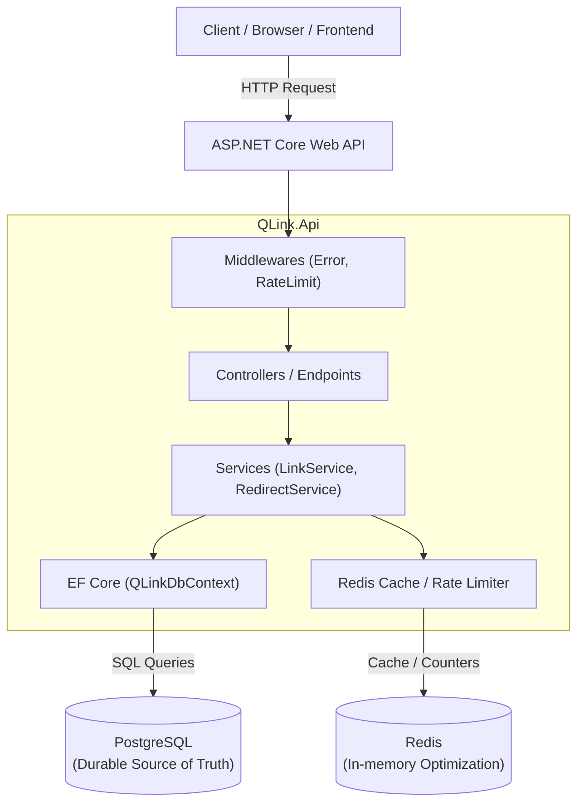
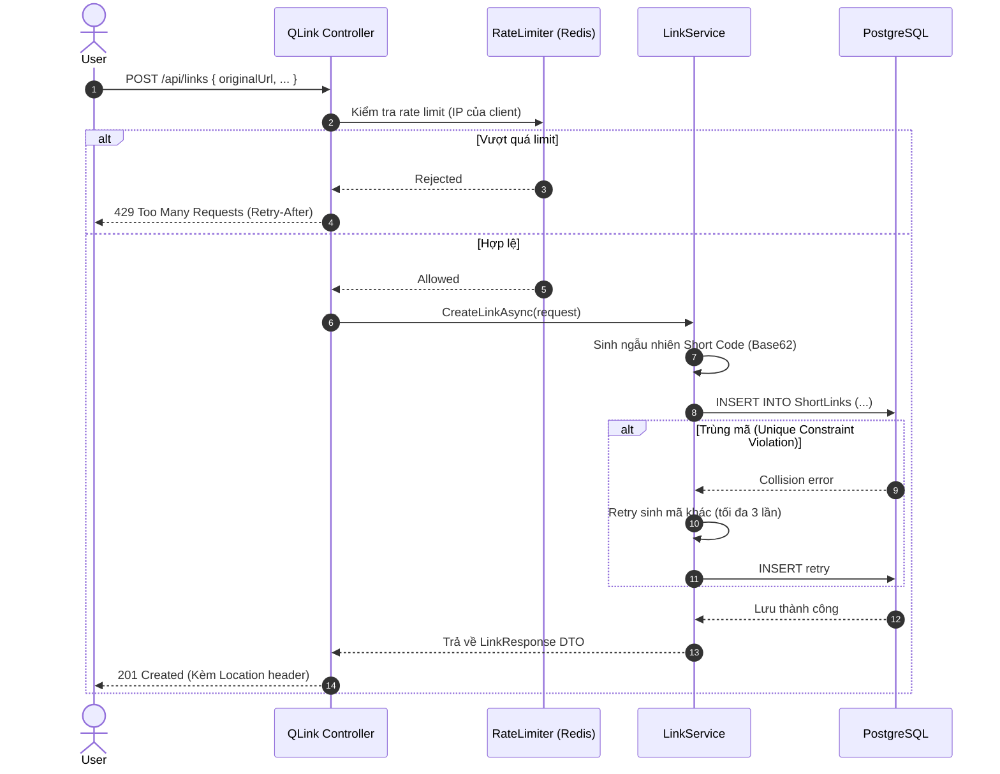
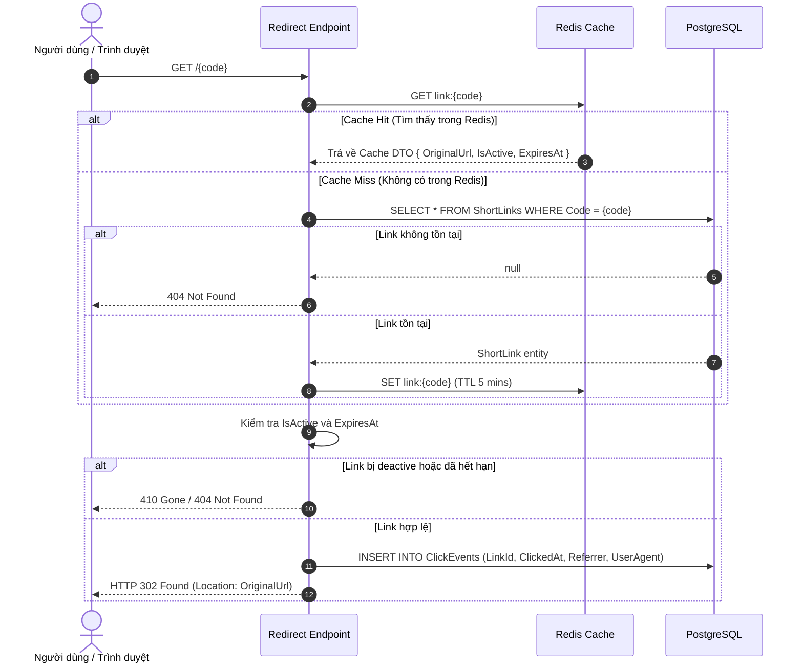

# Kiến Trúc Hệ Thống (Architecture & System Design)

Tài liệu này mô tả chi tiết kiến trúc tổng thể, mô hình thiết kế phần mềm, cấu trúc thư mục và luồng dữ liệu (Data Flow) trong dự án **QLink**.

---

## 🏗️ 1. Phong Cách Kiến Trúc (Architecture Style)

QLink được thiết kế theo phong cách **Modular Monolith** (Nguyên khối nhưng phân tầng rõ ràng).  
- **Không vội vàng chia Microservices**: Giúp giảm thiểu tối đa overhead về mạng, distributed tracing và sự phức tạp trong triển khai ban đầu.
- **Phân tách trách nhiệm mạch lạc (Separation of Concerns)**:
  - **Controllers / Endpoints Layer**: Chỉ chịu trách nhiệm tiếp nhận HTTP Request, validate cú pháp đầu vào và trả về HTTP Response tương ứng.
  - **Service / Application Layer**: Chứa toàn bộ nghiệp vụ logic cốt lõi (tính toán, sinh mã short code, điều phối cache và database).
  - **Data / Persistence Layer**: Làm việc trực tiếp với PostgreSQL thông qua Entity Framework Core.
  - **Infrastructure Layer**: Đóng gói các dịch vụ bên ngoài như Redis Cache, Redis Rate Limiting.



---

## 📂 2. Cấu Trúc Mã Nguồn (Solution Layout)

Cấu trúc thư mục được thiết kế theo chuẩn conventions của .NET:

```text
QLink/
├── QLink.sln                  # File giải pháp Solution
├── spec.md                       # Đặc tả yêu cầu kỹ thuật gốc
├── compose.yaml                  # Docker Compose môi trường dev/local
├── Dockerfile                    # Multi-stage Dockerfile cho API
├── .env.example                  # File biến môi trường mẫu
├── docs/                         # Thư mục tài liệu kỹ thuật & học tập
│   ├── README.md
│   ├── 01-learning-roadmap.md
│   ├── 02-architecture-design.md
│   ├── 03-api-specification.md
│   ├── 04-database-design.md
│   └── 05-redis-and-caching.md
├── src/
│   └── QLink.Api/
│       ├── Program.cs            # Entry point, DI container & HTTP Pipeline
│       ├── appsettings.json      # Cấu hình chuẩn của ứng dụng
│       ├── Contracts/            # DTOs tiếp nhận và trả về
│       │   ├── Requests/         # CreateLinkRequest, UpdateLinkRequest, ...
│       │   └── Responses/        # LinkResponse, LinkStatsResponse, ...
│       ├── Domain/               # Các thực thể thực tế (Entities)
│       │   ├── Common/           # BaseEntity (Id, CreatedAt, UpdatedAt)
│       │   └── Entities/         # ShortLink, ClickEvent
│       ├── Data/                 # Tầng dữ liệu Entity Framework Core
│       │   ├── QLinkDbContext.cs
│       │   ├── Configurations/   # Fluent API mapping configs
│       │   └── Migrations/       # Các file migration tự sinh của EF Core
│       ├── Services/             # Logic nghiệp vụ ứng dụng
│       │   ├── ILinkService.cs & LinkService.cs
│       │   ├── IRedirectService.cs & RedirectService.cs
│       │   ├── IStatsService.cs & StatsService.cs
│       │   └── ICodeGenerator.cs & Base62CodeGenerator.cs
│       ├── Infrastructure/       # Kết nối hạ tầng ngoài
│       │   ├── Cache/            # ICacheService, RedisCacheService
│       │   └── RateLimiting/     # RedisRateLimiter
│       ├── Common/               # Tiện ích chung, Result pattern hoặc Helpers
│       └── Middlewares/          # ExceptionHandlingMiddleware, RateLimitMiddleware
└── tests/
    ├── QLink.UnitTests/       # Kiểm thử đơn vị (Business logic, validation)
    └── QLink.IntegrationTests/# Kiểm thử tích hợp (API + Postgres/Redis)
```

---

## 🔄 3. Sơ Đồ Luồng Dữ Liệu (Data Flow)

### 3.1. Luồng Tạo Short Link (`POST /api/links`)



---

### 3.2. Luồng Redirect & Ghi Nhận Click (`GET /{code}`)



---

## 💉 4. Quản Lý Dependency Injection (DI)

ASP.NET Core tích hợp sẵn IoC Container. Việc đăng ký vòng đời dịch vụ (Lifetime) phải tuân thủ nghiêm ngặt:

| Thành phần / Interface | Implementation | Lifetime | Lý do lựa chọn |
|---|---|---|---|
| `QLinkDbContext` | `QLinkDbContext` | **Scoped** | Mỗi HTTP Request có một vòng đời DbContext riêng, tự động dispose và quản trị Unit of Work. |
| `IConnectionMultiplexer` | `ConnectionMultiplexer` | **Singleton** | Đối tượng kết nối Redis được thiết kế để dùng chung trong toàn bộ app, thread-safe và tái sử dụng connection pool. |
| `ICacheService` | `RedisCacheService` | **Singleton / Scoped** | Dựa trên IConnectionMultiplexer, không lưu trữ state riêng. |
| `ILinkService`, `IRedirectService` | `LinkService`, `...` | **Scoped** | Phụ thuộc vào `QLinkDbContext`, phải cùng vòng đời với DbContext để tránh DbContext concurrency issue. |
| `ICodeGenerator` | `Base62CodeGenerator` | **Singleton** | Thuần logic sinh chuỗi ngẫu nhiên không có state phụ thuộc HTTP context. |

---

## ⚠️ 5. Chiến Lược Xử Lý Lỗi (Error Handling)

Hệ thống tuân thủ tiêu chuẩn **RFC 7807 Problem Details for HTTP APIs**:

```json
{
  "type": "https://tools.ietf.org/html/rfc9110#section-15.5.5",
  "title": "Link Not Found",
  "status": 404,
  "detail": "Short link with code 'xyz123' does not exist or has been removed.",
  "instance": "/xyz123"
}
```

- Sử dụng `app.UseExceptionHandler()` và cấu hình `ProblemDetails` middleware tích hợp sẵn trong .NET 8/9.
- Không để lộ chi tiết exception stack trace, thông tin DB, connection string ra môi trường production.
