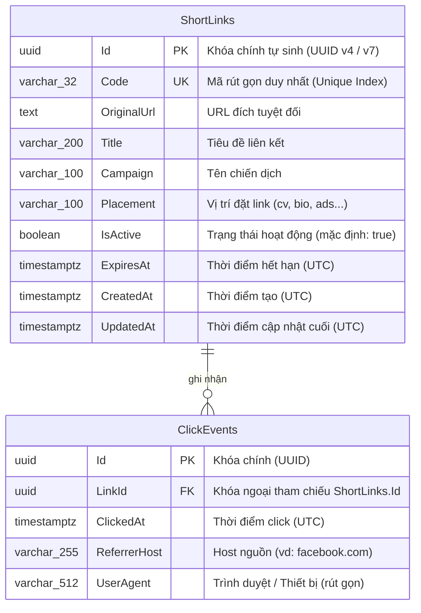

# Thiết Kế Cơ Sở Dữ Liệu & Entity Framework Core (Database Design)

Tài liệu này chi tiết hóa cấu trúc bảng, kiểu dữ liệu, các ràng buộc (constraints), chỉ mục (indexes) và mẫu mã nguồn cấu hình Fluent API trong **PostgreSQL** và **Entity Framework Core**.

---

## 🏛️ 1. Sơ Đồ Thực Thể (ERD)



---

## 📊 2. Chi Tiết Các Bảng Dữ Liệu

### Bảng 1: `ShortLinks`

Lưu trữ thông tin liên kết rút gọn.

| Cột | Kiểu Dữ Liệu PostgreSQL | Ràng Buộc (Constraints) | Mô Tả |
|---|---|---|---|
| `Id` | `uuid` | `PRIMARY KEY` | Định danh duy nhất toàn hệ thống. |
| `Code` | `varchar(32)` | `NOT NULL`, `UNIQUE INDEX` | Short code (vd: `aB39xQ`). |
| `OriginalUrl` | `text` | `NOT NULL` | URL gốc đích cần chuyển hướng. |
| `Title` | `varchar(200)` | `NULL` | Tiêu đề mô tả link. |
| `Campaign` | `varchar(100)` | `NULL` | Tên chiến dịch (phục vụ lọc & phân nhóm). |
| `Placement` | `varchar(100)` | `NULL` | Vị trí đặt link. |
| `IsActive` | `boolean` | `NOT NULL`, Default `true` | Đánh dấu xóa mềm / vô hiệu hóa. |
| `ExpiresAt` | `timestamptz` | `NULL` | Hết hạn tự động sau thời điểm này. |
| `CreatedAt` | `timestamptz` | `NOT NULL` | Thời gian tạo bản ghi (UTC). |
| `UpdatedAt` | `timestamptz` | `NOT NULL` | Thời gian sửa bản ghi (UTC). |

---

### Bảng 2: `ClickEvents`

Lưu trữ từng sự kiện click đi qua short link.

| Cột | Kiểu Dữ Liệu PostgreSQL | Ràng Buộc (Constraints) | Mô Tả |
|---|---|---|---|
| `Id` | `uuid` | `PRIMARY KEY` | Định danh bản ghi click. |
| `LinkId` | `uuid` | `NOT NULL`, `FOREIGN KEY` | Tham chiếu tới `ShortLinks(Id)` (OnDelete: Cascade hoặc Restrict). |
| `ClickedAt` | `timestamptz` | `NOT NULL` | Thời điểm phát sinh click (UTC). |
| `ReferrerHost` | `varchar(255)` | `NULL` | Tên miền nguồn chuyển tới (ví dụ: `google.com`). |
| `UserAgent` | `varchar(512)` | `NULL` | Chuỗi User-Agent của client (cắt ngắn để tránh phình dung lượng). |

> 🔒 **Quy tắc bảo mật & quyền riêng tư (Privacy):**
> QLink **không lưu IP thô (raw IP)** của người dùng để tuân thủ quyền riêng tư và tránh các rủi ro bảo mật không đáng có cho một dự án rút gọn link.

---

## ⚡ 3. Chiến Lược Chỉ Mục (Indexing Strategy)

1. **`IX_ShortLinks_Code` (Unique Index)**:
   - Mục đích: Đảm bảo không bao giờ có 2 link trùng code. Tối ưu hóa tối đa truy vấn tìm kiếm link khi redirect `WHERE Code = @code` với độ phức tạp `O(log N)`.
2. **`IX_ClickEvents_LinkId_ClickedAt` (Composite Index)**:
   - Mục đích: Tăng tốc cực lớn cho truy vấn thống kê:  
     `WHERE LinkId = @linkId AND ClickedAt >= @from AND ClickedAt <= @to ORDER BY ClickedAt`.
3. **`IX_ShortLinks_CreatedAt`**:
   - Phục vụ việc phân trang danh sách link ổn định (`ORDER BY CreatedAt DESC`).

---

## 💻 4. Cấu Hình EF Core Fluent API

Trong .NET, để code sạch sẽ và dễ bảo trì, chúng ta tách cấu hình từng Entity thành các class riêng triển khai interface `IEntityTypeConfiguration<T>`:

### 4.1. `ShortLinkConfiguration.cs`

```csharp
using QLink.Api.Domain.Entities;
using Microsoft.EntityFrameworkCore;
using Microsoft.EntityFrameworkCore.Metadata.Builders;

namespace QLink.Api.Data.Configurations;

public class ShortLinkConfiguration : IEntityTypeConfiguration<ShortLink>
{
    public void Configure(EntityTypeBuilder<ShortLink> builder)
    {
        builder.ToTable("ShortLinks");

        builder.HasKey(x => x.Id);

        builder.Property(x => x.Code)
            .IsRequired()
            .HasMaxLength(32);

        builder.HasIndex(x => x.Code)
            .IsUnique();

        builder.Property(x => x.OriginalUrl)
            .IsRequired();

        builder.Property(x => x.Title)
            .HasMaxLength(200);

        builder.Property(x => x.Campaign)
            .HasMaxLength(100);

        builder.Property(x => x.Placement)
            .HasMaxLength(100);

        builder.Property(x => x.IsActive)
            .IsRequired()
            .HasDefaultValue(true);

        builder.Property(x => x.CreatedAt)
            .IsRequired();

        builder.Property(x => x.UpdatedAt)
            .IsRequired();

        // Mối quan hệ 1-Nhiều với ClickEvents
        builder.HasMany(x => x.ClickEvents)
            .WithOne(x => x.ShortLink)
            .HasForeignKey(x => x.LinkId)
            .OnDelete(DeleteBehavior.Cascade);
    }
}
```

### 4.2. `ClickEventConfiguration.cs`

```csharp
using QLink.Api.Domain.Entities;
using Microsoft.EntityFrameworkCore;
using Microsoft.EntityFrameworkCore.Metadata.Builders;

namespace QLink.Api.Data.Configurations;

public class ClickEventConfiguration : IEntityTypeConfiguration<ClickEvent>
{
    public void Configure(EntityTypeBuilder<ClickEvent> builder)
    {
        builder.ToTable("ClickEvents");

        builder.HasKey(x => x.Id);

        builder.Property(x => x.ClickedAt)
            .IsRequired();

        builder.Property(x => x.ReferrerHost)
            .HasMaxLength(255);

        builder.Property(x => x.UserAgent)
            .HasMaxLength(512);

        // Index kết hợp quan trọng cho query thống kê
        builder.HasIndex(x => new { x.LinkId, x.ClickedAt });
    }
}
```

---

## ⏰ 5. Quy Tắc UTC Timestamp Trong Npgsql

PostgreSQL phân biệt rõ giữa `timestamp` (không có timezone) và `timestamptz` (timestamp with time zone).
- Trong C#, luôn sử dụng `DateTime.UtcNow` thay vì `DateTime.Now`.
- Đảm bảo `Kind` của `DateTime` luôn là `DateTimeKind.Utc` trước khi gửi xuống database để tránh exception phổ biến của Npgsql:
  `Cannot write DateTime with Kind=Unspecified to PostgreSQL type 'timestamp with time zone'`.

---

## 🚀 6. Quy Trình Tạo & Áp Dụng EF Core Migration

```powershell
# 1. Cài công cụ dotnet-ef nếu máy chưa có
dotnet tool install --global dotnet-ef

# 2. Tạo migration mới
dotnet ef migrations add InitialCreate --project src/QLink.Api

# 3. Cập nhật database PostgreSQL
dotnet ef database update --project src/QLink.Api
```
