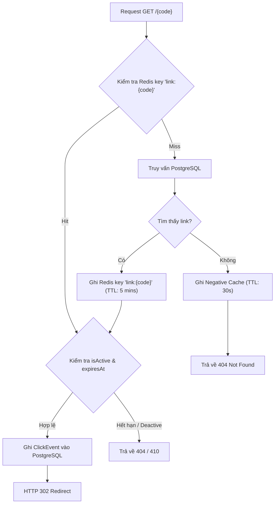

# Chiến Lược Redis Caching & Rate Limiting (Redis Design & Resilience)

Tài liệu này giải thích chi tiết vai trò của **Redis** trong dự án QLink, cách thức triển khai mô hình **Cache-Aside**, chiến lược làm mới cache (Invalidation), cơ chế tự phục hồi (Fallback Resilience), và thuật toán **Distributed Rate Limiting** bằng Redis Lua Script.

---

## 🧭 1. Vai Trò Của Redis Trong QLink

Trong QLink, cần ghi nhớ nguyên tắc cốt lõi:
- **PostgreSQL là Source of Truth**: Dữ liệu link, lượt click và cấu hình hệ thống luôn được lưu trữ bền vững tại PostgreSQL.
- **Redis là tầng tối ưu hóa & phối hợp (Optimization & Coordination)**:
  1. Giảm thiểu tải truy vấn `SELECT` đọc database khi có hàng ngàn lượt click redirect đồng thời.
  2. Phối hợp kiểm soát tần suất tạo link (Rate Limiting) xuyên suốt nhiều instance của API.
  3. **Mất Redis không làm mất dữ liệu người dùng**: Ứng dụng vẫn có thể hoạt động bình thường bằng cách fallback về PostgreSQL.

---

## ⚡ 2. Mô Hình Cache-Aside Cho Redirect Lookup

### 2.1. Cấu Trúc Key và DTO Cache

- **Định dạng Key**: `link:{code}` (ví dụ: `link:mycv2026`).
- **DTO Cache**: Tránh serialize toàn bộ entity `ShortLink` (gây tốn bộ nhớ và lộ thông tin không cần thiết). Chỉ lưu các trường tối thiểu cần thiết để quyết định redirect:

```csharp
public record CachedLinkDto(
    string OriginalUrl,
    bool IsActive,
    DateTime? ExpiresAt
);
```

### 2.2. Vòng Đời Truy Vấn (Query Lifecycle)



### 2.3. Negative Caching (Chống Đục Thủng Cache - Cache Penetration)
Nếu kẻ tấn công gửi liên tục hàng triệu request với mã code ngẫu nhiên không tồn tại, nếu không có cache thì 100% request sẽ đánh thẳng vào PostgreSQL.  
- **Giải pháp**: Nếu database trả về `null`, lưu một giá trị đặc biệt (ví dụ `__NOT_FOUND__`) vào Redis với TTL ngắn (15–30 giây).

---

## 🔄 3. Chiến Lược Làm Mới Cache (Cache Invalidation)

> *"Có hai thứ khó nhất trong ngành khoa học máy tính: Đặt tên biến và Làm mới cache (Cache Invalidation)."* — Phil Karlton

Khi dữ liệu gốc thay đổi, dữ liệu trong Redis có nguy cơ bị lỗi thời (stale data).  
Quy tắc làm mới cache trong QLink:
1. **Khi Update Link (`PATCH /api/links/{code}`)**:
   - Cập nhật PostgreSQL thành công trong transaction.
   - Gọi `redis.KeyDeleteAsync($"link:{code}")` để xóa cache. Lần truy vấn redirect tiếp theo sẽ tự động load dữ liệu mới nhất từ PostgreSQL vào Redis.
2. **Khi Deactivate Link (`DELETE /api/links/{code}`)**:
   - Cập nhật `IsActive = false` trong PostgreSQL.
   - Xóa ngay lập tức key `link:{code}` trong Redis để chặn redirect ngay lập tức.
3. **TTL (Time-To-Live)**:
   - TTL mặc định: `300 giây` (5 phút). TTL đóng vai trò là "lưới bảo vệ dự phòng" (safety net) giúp dọn dẹp các key không còn được truy cập, không phải là cơ chế duy nhất để kiểm tra tính hợp lệ của link.

---

## 🛡️ 4. Cơ Chế Fallback Khi Redis Sự Cố (Resilience & Degradation)

Điều gì xảy ra nếu container Redis bị crash, quá tải hoặc mất kết nối mạng?  
👉 **Ứng dụng KHÔNG ĐƯỢC PHÉP sập (500 Internal Server Error)!**

```csharp
public async Task<CachedLinkDto?> GetLinkWithFallbackAsync(string code, CancellationToken ct)
{
    try
    {
        // 1. Thử lấy từ Redis
        var cached = await _redisCache.GetAsync<CachedLinkDto>($"link:{code}");
        if (cached != null) return cached;
    }
    catch (RedisException ex)
    {
        // Log cảnh báo, tuyệt đối không throw lỗi ra ngoài làm ngắt quãng request
        _logger.LogWarning(ex, "Redis không khả dụng. Tự động fallback về PostgreSQL.");
    }

    // 2. Fallback truy vấn PostgreSQL
    var link = await _dbContext.ShortLinks
        .AsNoTracking()
        .FirstOrDefaultAsync(x => x.Code == code, ct);

    if (link == null) return null;

    var dto = new CachedLinkDto(link.OriginalUrl, link.IsActive, link.ExpiresAt);

    // 3. Thử ghi lại vào Redis nếu Redis đã hồi phục
    try
    {
        await _redisCache.SetAsync($"link:{code}", dto, TimeSpan.FromMinutes(5));
    }
    catch (RedisException)
    {
        // Bỏ qua lỗi ghi cache khi Redis chưa sẵn sàng
    }

    return dto;
}
```

---

## 🚦 5. Giới Hạn Tốc Độ Phân Tán (Distributed Rate Limiting)

### 5.1. Tại sao In-memory Rate Limiting là chưa đủ?
Nếu hệ thống mở rộng chạy 3 container API đằng sau một Load Balancer (Nginx):
- Nếu dùng Rate Limiter lưu trong RAM của C#, một người dùng có thể gửi 20 request vào API-1, 20 request vào API-2, 20 request vào API-3 => Tổng cộng 60 request/phút mà không bị chặn.
- Do đó, cần một bộ đếm tập trung trên **Redis**.

### 5.2. Chống Race Condition Bằng Lua Script
Nếu bạn viết code C#:
```csharp
// ❌ SAI: Dễ bị race condition khi nhiều request đồng thời
var count = await redis.StringGetAsync(key);
if (count < 20) {
    await redis.StringIncrementAsync(key);
}
```
Hai request tới cùng lúc có thể cùng đọc giá trị 19, và cả hai đều được chấp nhận, vượt qua giới hạn 20.

### 5.3. Lua Script Thực Thi Nguyên Tử (Atomic Execution)

```lua
-- KEYS[1]: rate_limit:{ip}:{window}
-- ARGV[1]: Giới hạn tối đa (vd: 20)
-- ARGV[2]: Thời gian sống của window tính bằng giây (vd: 60)

local current = redis.call('INCR', KEYS[1])
if current == 1 then
    redis.call('EXPIRE', KEYS[1], ARGV[2])
end

if current > tonumber(ARGV[1]) then
    return 0 -- Bị chặn (Rate limit exceeded)
else
    return 1 -- Hợp lệ (Allowed)
end
```

Khi nhận kết quả `0`, middleware sẽ ngắt pipeline và trả về ngay:
- HTTP Status: `429 Too Many Requests`
- Header: `Retry-After: 60`
- Body: Chuẩn `ProblemDetails` giải thích rõ lý do.
